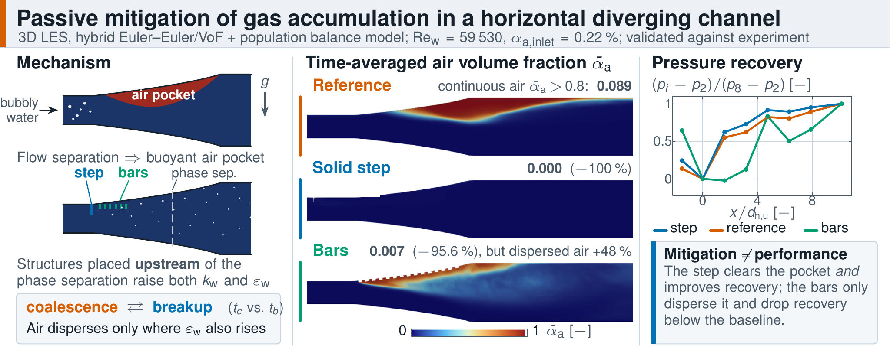

# Passive mitigation of gas accumulation in diffusers

**Bubbly flow in a horizontal diffuser separates, and the air collects in a pocket that blocks the passage. Can a small structure upstream prevent this?** This repository contains the simulation setups, post-processing and figure data for the study that answers that question with 2D URANS and 3D large-eddy simulations, validated against experiments.

[](https://papers.ssrn.com/sol3/papers.cfm?abstract_id=7649860)

<!-- add once available: [](https://doi.org/10.5281/zenodo.XXXXXXX) -->



> C. Park, M. Mansour, D. Thévenin, R. Skoda. **Passive Mitigation of Gas Accumulation by Surface Structures in Diverging Flow Channels: A Three-Dimensional Two-Phase Flow Simulation Study.** Preprint: [SSRN 7649860](https://papers.ssrn.com/sol3/papers.cfm?abstract_id=7649860) <!-- add journal + DOI once published -->

## Key findings

- **Placement matters more than the device.** Air accumulation is mitigated only when turbulent mixing is raised *upstream* of the point where the phases separate. Structures that add turbulence further downstream do not break up the air pocket.
- **A solid step removes the air pocket completely** (continuous-air fraction 0.089 → 0.000 in the 3D LES) **and improves pressure recovery.**
- **Bars nearly remove it (−95.6 %) but lower pressure recovery below the unmodified diffuser**, because their form drag and wake losses outweigh the gain. Dispersing the gas and keeping the diffuser efficient are separate goals.
- **Dissipation, not just turbulent kinetic energy, drives dispersion.** Bubble breakup competes with coalescence. The step raises both k and ε; the bars raise k but barely ε, so their breakup effect is local and weaker.
- **Model limitation, stated openly:** the coalescence and breakup kernels are grid-dependent and sensitive to their constants. The predicted bubble size distribution is therefore not grid-independent, although the size and position of the air pocket are not affected.

## Method

| | |
|---|---|
| Geometry | Horizontal diffuser, 40 × 44 mm inlet duct → 100 × 44 mm outlet duct; gravity normal to the main flow (emulates Coriolis forces in radial pump impellers) |
| Configurations | Reference (no structure), solid cross-flow step, transverse bars |
| Operating range | Re_w = 59 530 – 78 330 (Q_w = 9.5 – 12.5 m³/h); air injected upstream |
| Two-phase model | Hybrid Euler–Euler / Volume-of-Fluid solver: dispersed bubbles and continuous air pockets in one framework, with population balance (Luo–Svendsen breakup, Prince–Blanch coalescence) |
| Turbulence | 2D: URANS with k-ω SST over the full operating range. 3D: LES (WALE) for selected cases |
| Interfacial forces | Drag and virtual mass (dominant in horizontal bubbly flow), surface tension (CSF) |
| Validation | Experiments at Otto von Guericke University Magdeburg: shadowgraphy of the air pocket, bubble size distributions, wall pressure, LDA velocity (single phase) |
| Code | OpenFOAM Foundation v9 + [OpenFOAM-PhD-Extensions](https://github.com/cpark247/OpenFOAM-PhD-Extensions) (hybrid solver family `multiphaseEulerFoamHSM`, extended from Hundshagen et al.) |

## Repository layout

```
cases/            OpenFOAM case setups (0.orig/, constant/, system/) per configuration
postprocessing/   Python scripts that turn raw OpenFOAM output into the figure data
figures/          figure data (CSV) and the scripts that plot each paper figure
data/             pointer to the full field data on Zenodo (too large for git)
docs/             graphical abstract and repository images
```

`figures/README.md` maps every paper figure to the script and data that produce it.

## Reproducing the results

1. Build [OpenFOAM-PhD-Extensions](https://github.com/cpark247/OpenFOAM-PhD-Extensions) against OpenFOAM Foundation v9.
2. Run a configuration from `cases/` (see `cases/README.md`). The 3D LES need an HPC cluster; the cost of each run is listed per case.
3. Either use your own results or download the processed data from Zenodo (`data/README.md`), then run the scripts in `figures/`.

## Related

- [OpenFOAM-PhD-Extensions](https://github.com/cpark247/OpenFOAM-PhD-Extensions): solver and models used here
- [turbulence-validation-OF9](https://github.com/cpark247/turbulence-validation-OF9): preliminary single-phase turbulence-modelling studies from the same doctoral project (not used for the results here)

## Acknowledgements

Supported by the Federal Ministry for Economic Affairs and Energy (BMWE) based on a decision by the German Bundestag, research project number 01IF 23051 N, and by the Verband Deutscher Maschinen- und Anlagenbau e.V. (VDMA) Pumps + Systems. Computing time was provided by the NHR Center NHR4CES at RWTH Aachen University (project p0021456).

## Citation

Please cite the paper above. The repository itself can be cited via `CITATION.cff` (and the Zenodo DOI once minted).

## Licence

Scripts and case setups: MIT (see `LICENSE`). Experimental data are not redistributed here; see `data/README.md`.
