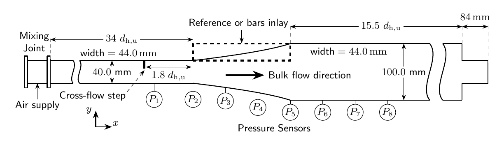
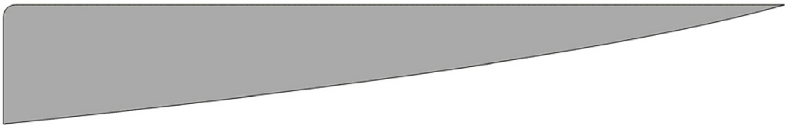
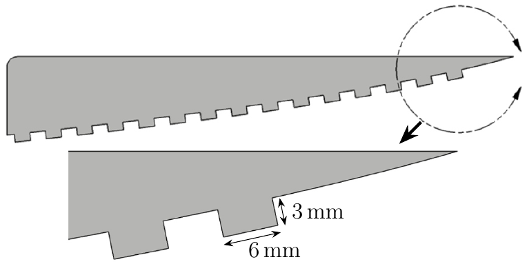
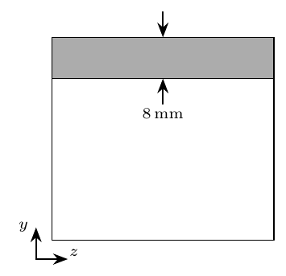
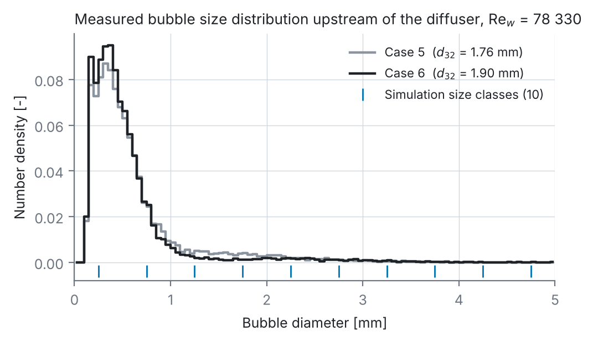

# 3 Test case and experimental data

[← 2 Method](02_method.md) · [Overview](../README.md) · [4 Results: 2D URANS →](04_2d_urans.md)

## Diffuser

Test section with replaceable upper-wall inlay, pressure sensors P1–P8 and the position of the cross-flow step. Geometry adapted from Mansour et al.

| | |
|---|---|
| Inlet duct | 40 mm × 44 mm (height × width), hydraulic diameter dh,u = 42 mm, fully developed turbulent flow |
| Diffuser | Opening angle increasing in flow direction (both walls diverge), provoking separation and air accumulation |
| Outlet duct | 100 mm × 44 mm, dh = 61 mm |
| Orientation | Horizontal, gravity acts normal to the main flow and drives air towards the upper wall, emulating the Coriolis force in radial impellers |
| Operating range | Qw = 9.5–12.5 m³/h, Rew = cbulk,w dh,u/νw = 59 530–78 330; air up to Qa = 2.121·10⁻² m³/h |
| Cavitation | Excluded (cavitation number ≈ 18.5 ≫ 0.3) |

The upper-wall contour (normalised, from the centreline) is in [`data/diffuser_upper_wall_contour.csv`](../data/diffuser_upper_wall_contour.csv).

## Mitigation structures

| Reference inlay | Bars inlay | Cross-flow step |
|:---:|:---:|:---:|
|  |  |  |
| Smooth upper wall (baseline) | Bars 6 mm wide, 3 mm deep, machined into the diverging wall; periodic obstruction to raise turbulence | Stainless-steel sheet, 8 mm high, 0.5 mm thick, mounted 1.8 dh,u upstream of the diffuser; local blockage upstream of phase separation |

These were the most effective structures in the experiments. They were investigated separately, never together.

## Experiment (Otto von Guericke University Magdeburg)

| Quantity | Technique | Details |
|---|---|---|
| Air pocket size and position | High-speed shadowgraphy, LED backlight | 1500 images at 50 Hz, time-averaged, binarised by a histogram-based threshold; pocket assumed to span the full width; air void fraction = air volume / channel volume downstream of the diffuser inlet |
| Bubble size distribution | Second high-speed camera, DaVis 8.4 particle sizing | 25 × 40 mm window, 0.6 dh,u upstream of the diffuser; 500 images, > 10⁴ bubbles per point; uncertainty < 4.9 % |
| Wall pressure | Endress+Hauser Cerabar T PMC131, mid-span, bottom wall | 8 Hz over 15 min, ≥ 3 repetitions; overall uncertainty 2.9 % of reading |
| Velocity (water only) | 2-component LDA (Dantec) | 325 points, 10 × 7.5 mm grid, ~25 000 samples per point, uncertainty < 0.5 % |
| Flow rates | Electromagnetic flow meter (water), rotameter (air) | 0.5 % and 2.5 % of reading; air injected through 21 holes of 1 mm in a mixing joint |

Pressure transducer locations ([`data/pressure_taps.csv`](../data/pressure_taps.csv)):

| | P1 | P2 | P3 | P4 | P5 | P6 | P7 | P8 |
|---|---|---|---|---|---|---|---|---|
| x/dh,u | −1.5 | 0 | 1.6 | 3.17 | 4.75 | 6.3 | 7.9 | 10.1 |

Measured bubble size distributions for Cases 5 and 6 with the simulation's ten size classes. Re-plotted from [`data/bubble_size_distribution_experiment.csv`](../data/bubble_size_distribution_experiment.csv); d32 computed from the bubble counts.

## Operating points

| Case | Rew | αa,inlet experiment [%] | αa,inlet 2D simulation [%] | Used in |
|---|---|---|---|---|
| 1 | 59 530 | 0 | 0 | single-phase validation |
| 2 | 78 330 | 0 | 0 | 2D grid study |
| 3 | 59 530 | 0.074 | 0.100 | 2D |
| 4 | 59 530 | 0.223 | 0.200 | 2D and **3D LES** |
| 5 | 78 330 | 0.056 | 0.100 | 2D |
| 6 | 78 330 | 0.169 | 0.200 | 2D |

The 2D inlet air fraction differs from the experiment on purpose: before the diffuser, buoyancy and the corner vortices of the duct concentrate the air at the upper wall around mid-span. A 2D model cannot represent this, so αa,inlet was adjusted to roughly match the measured pocket size. In the 3D LES the measured value (0.223 %) is used.

Even very small air loadings (~0.05 %) produced a sizeable pocket in this diffuser. At lower Rew the phases were essentially separated with only a small dispersed wake.
