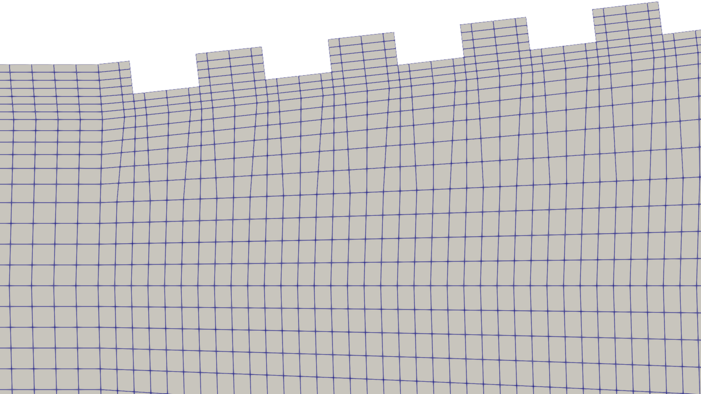
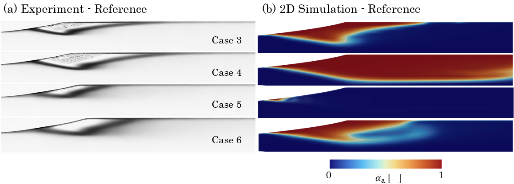
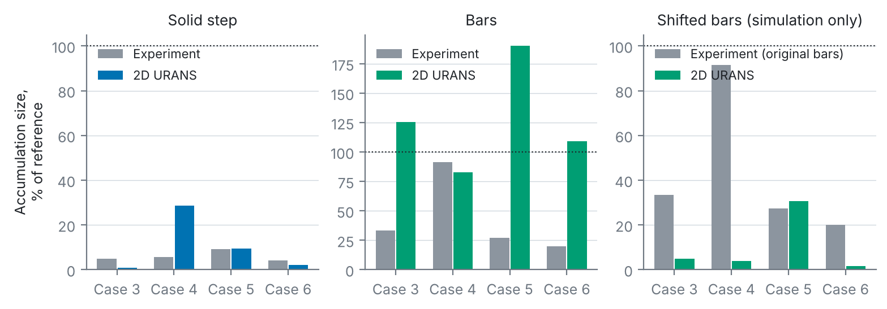
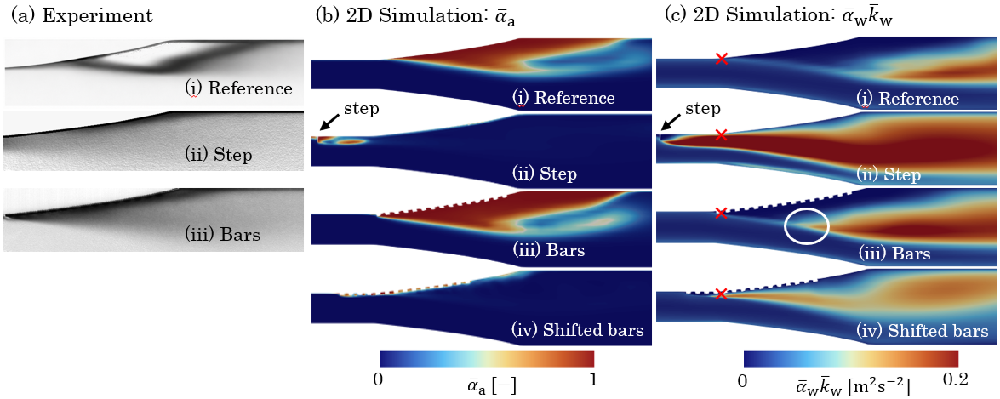
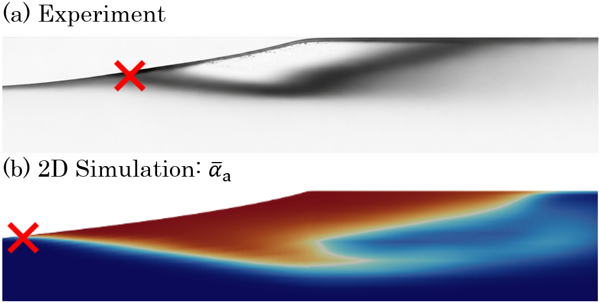

# 4 Results: 2D URANS parameter study

[← 3 Test case](03_test_case.md) · [Overview](../README.md) · [5 Results: 3D LES →](05_3d_les.md)

Both structures have no spanwise variation, so a 2D setup was used first to cover all six operating points at low cost, with the full hybrid model and population balance but the k-ω SST model instead of LES.

## Setup

- Upstream channel of 60 dh,u so that a fully developed two-phase flow enters the diffuser; downstream length as in the experiment.
- Structured hexahedral grids. Grid study on the reference: G1/G2/G3 = 3 000/9 000/35 000 cells. Single-phase separation and reattachment are grid-independent on G2 (y⁺ = 20–45), which is used for all configurations (bars 13 000, step 10 000 cells, refined near the structures).
- 10 bubble size classes (0.25–4.75 mm), 0.25 mm bubbles at the inlet.

Cut-out of the G2 grid for the bars configuration.

**Two model limitations surfaced here and were accepted for a comparative study:**

1. With two-phase flow (Case 6), the predicted pocket keeps shrinking with grid refinement. Strict grid independence is not reached, attributed to the grid dependence of the coalescence and breakup kernels (also seen in earlier pump simulations).
2. The simulated bubble size distribution stays essentially monodisperse at 0.25 mm, unlike the measured one. Calibrating the kernels could fix this but was outside the scope.

Because the focus is the effect of the structures *relative to the reference*, the same resolution level is used throughout.

## Accumulation size, reference configuration

Time-averaged (a) shadowgraphy and (b) simulated air volume fraction, upper half of the diffuser, Cases 3–6.

The match is approximate (Case 4 over-, Case 5 under-predicted), but the trends are right: more inlet air means a larger pocket (Case 3 → 4, 5 → 6), and a higher Reynolds number means a smaller one (Case 4 → 6).

## Effect of the structures

Air accumulation size relative to the reference (simulation: interface at ᾱa = 0.8). Re-plotted from [`data/air_accumulation_relative_2d.csv`](../data/air_accumulation_relative_2d.csv).

- **Step:** mitigation reproduced well (Case 4 overestimated, partly inherited from the reference).
- **Bars:** the simulation fails to show the mitigation seen in the experiment, except in Case 4, where the experiment itself shows little effect.

## Why the bars fail in 2D

Case 6: (a) shadowgraphy, (b) ᾱa, (c) mixing intensity ᾱw k̄w for (i) reference, (ii) step, (iii) bars, (iv) bars shifted upstream. The cross marks the reference phase-separation point.

The water-fraction-weighted turbulent kinetic energy ᾱw k̄w measures mixing. The step raises it strongly, and the pocket disappears. The bars raise it too, but **only downstream of the phase-separation point**.

Phase-separation point in experiment and 2D simulation (reference, Case 6). The 2D model places it too far upstream.

The 2D model predicts flow separation, and with it phase separation, too far upstream (confirmed by the single-phase comparison in [section 5](05_3d_les.md#single-phase-validation)). The bars therefore act too late.

**Test:** shifting the bars upstream in the 2D model, so that the extra mixing starts just upstream of phase separation, mitigates the accumulation in every case (panel c of the bar chart above).

> **Conclusion of the 2D study:** mixing has to be raised *upstream of the phase-separation location* to dissipate air accumulation. Resolving the mechanism needs 3D LES.
