# 5 Results: 3D large-eddy simulation

[← 4 Results: 2D URANS](04_2d_urans.md) · [Overview](../README.md) · [6 Conclusions →](06_conclusions.md)

Because of its cost, the LES covers one operating point: **Case 4** (Rew = 59 530, αa,inlet = 0.223 %), a low enough Reynolds number for a well-resolved LES with a pronounced air pocket.

## Setup

| | |
|---|---|
| Diffuser domain | Diffuser with downstream constriction, plus 5 dh,u upstream |
| Grids | Reference: ≈ 2.5 M hexahedral cells (adapted from Nguyen et al. 2023, grid-independent pressure recovery for monodisperse flow). Step and bars: ≈ 2.9 M cells each |
| Resolution | Mean y⁺ ≈ 3 (max < 5); cell size / Kolmogorov length mean below ≈ 15 (max 18), close to the recommended 12; νt/ν ≈ 1.5 in most of the domain (max 3) |
| Inflow | Precursor LES of a 40 × 44 mm duct: single phase 4π dh,u periodic with bulk-velocity forcing; two-phase 60 dh,u long, ≈ 13 M cells, homogeneous air at its inlet. Plane at x = 58 dh,u recorded over three large-eddy turnover times and looped as a time-resolved inlet for velocity and volume fraction |
| Inlet bubble sizes | Measured distribution (mean of Cases 5 and 6) imposed directly, because the precursor's distribution is concentrated in the smallest class |
| Outlet / walls | Constant pressure / no slip |
| Initialisation | Converged monodisperse solution of Nguyen et al.; quasi-steady after ≈ 3 flow-through times |

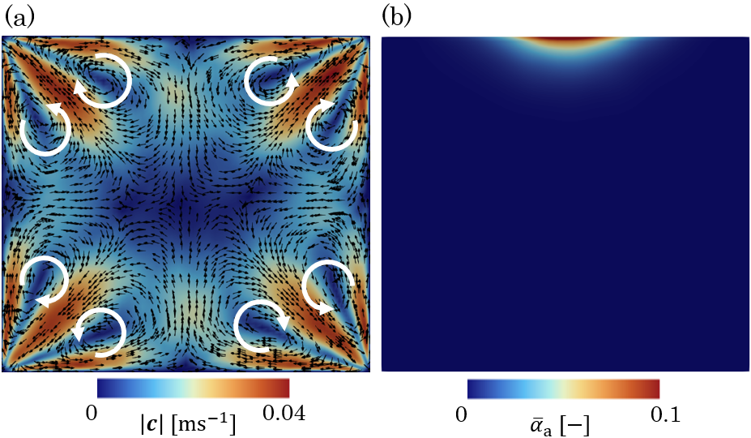
Precursor duct: (a) secondary flow of Prandtl's second kind (single phase) and (b) the resulting air concentration near the upper wall at mid-span (two-phase).

Statistical convergence was checked by averaging the tap pressures over successively longer windows from the end of the run, until successive means change by less than 0.01 %:

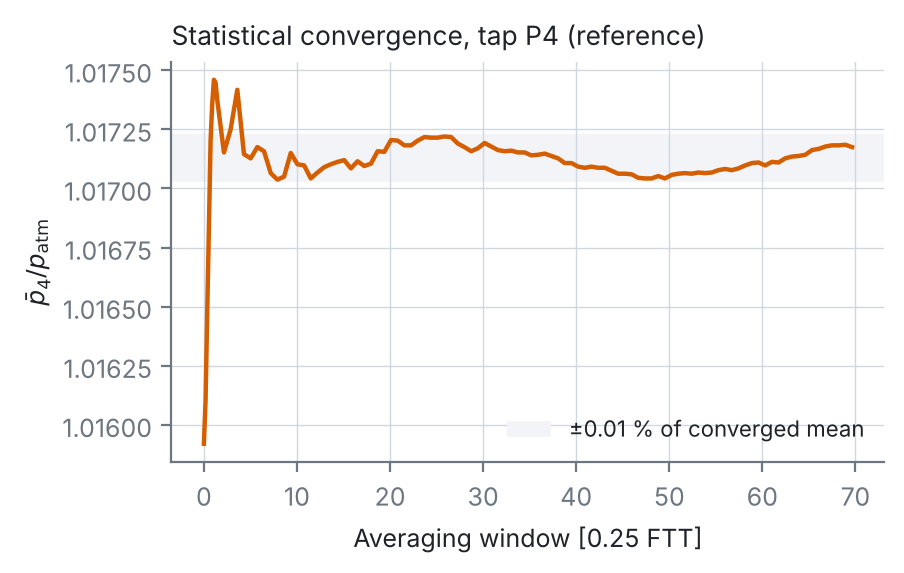

## Single-phase validation

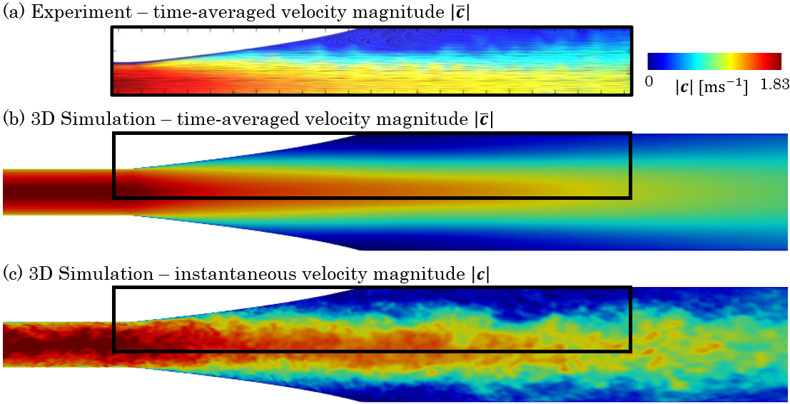
Mid-span velocity magnitude: (a) time-averaged LDA, (b) time-averaged LES, (c) instantaneous LES.

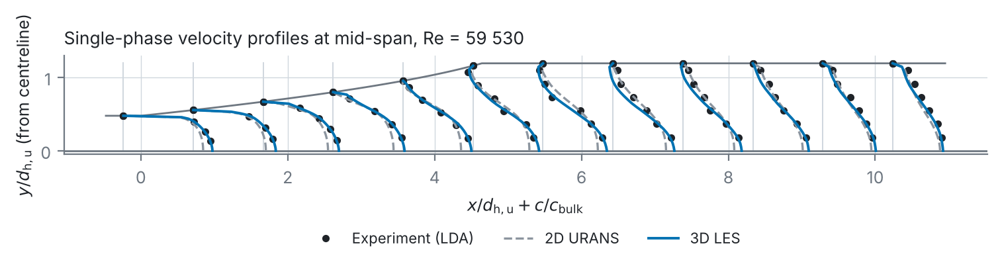
Velocity profiles at mid-span, re-plotted from [`data/velocity_profiles_single_phase.csv`](../data/velocity_profiles_single_phase.csv).

The 3D LES agrees well with the measurements. The 2D URANS looks similar at first glance, but it predicts **flow separation too far upstream**, whereas the LES places it close to the experiment. This single-phase error explains why phase separation was also too far upstream in 2D. Flow separation and phase separation are linked but do not coincide: the phases separate slightly upstream of the single-phase separation point.

## Reference configuration

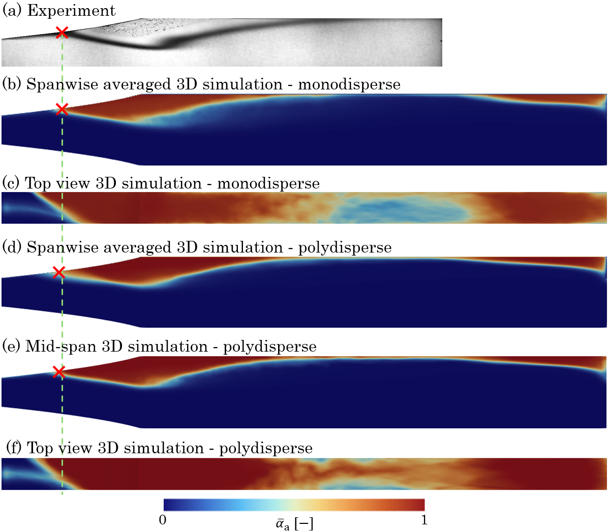
(a) Shadowgraphy; (b, c) monodisperse LES (dB = 0.3 mm) and (d–f) polydisperse LES: spanwise average, top view, mid-span. Crosses mark the phase-separation points; the dashed line the experimental one.

- Both 3D setups match the measured pocket size and place the phase-separation point very well, unlike 2D.
- **Monodisperse and polydisperse modelling give the same pocket size and separation point.**
- The top view shows a **spanwise skew** of the pocket in both setups. It is not a convergence, grid (symmetric to machine precision) or inlet artefact, and points to physical symmetry breaking, for example air pockets attaching to a corner or spanwise anti-symmetric Görtler instabilities. It was not studied experimentally.

All further results use the polydisperse setup.

## Air accumulation with the structures

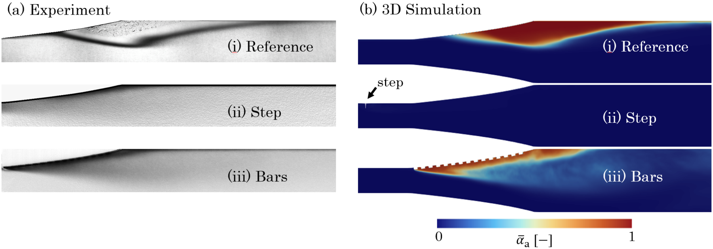
(a) Shadowgraphy and (b) spanwise-averaged ᾱa from the LES: (i) reference, (ii) step, (iii) bars.

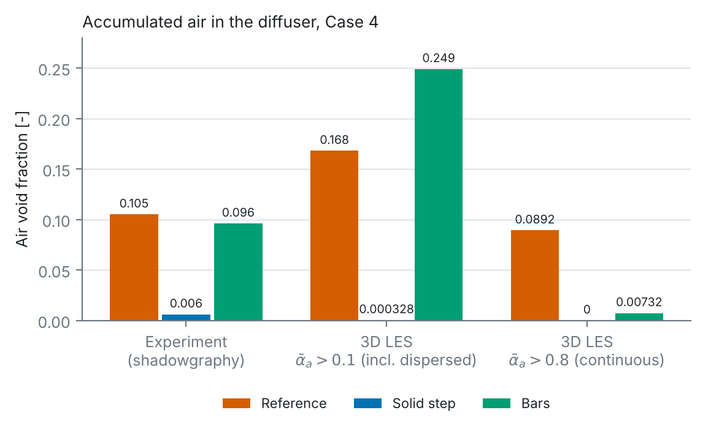
Air void fraction (AVF). Simulation: sum of ᾱa Vcell over cells above the threshold, divided by the diffuser volume from the inlet, as in the experiment. Data: [`data/air_void_fraction_3d.csv`](../data/air_void_fraction_3d.csv).

| Configuration | Experiment | LES, ᾱa > 0.1 (incl. dispersed) | LES, ᾱa > 0.8 (continuous) |
|---|---|---|---|
| Reference | 0.105 | 0.168 | 0.0892 |
| Step | 0.006 (−94.3 %) | 0.000328 (−99.8 %) | 0 (−100 %) |
| Bars | 0.096 (−8.57 %) | 0.249 (+48.2 %) | 0.00732 (−91.8 %) |

- The two thresholds bracket the measured reference value.
- **Step:** near-complete suppression in experiment and simulation.
- **Bars:** strongly threshold-dependent. The continuous pocket almost disappears, but the dispersed air grows, so the interface becomes diffuse rather than sharp. In the experiment, the bars are weak for this operating point (Case 4 is where they work least, see section 4).
- Threshold-based volumes are grid-dependent and should be read as morphology indicators (dispersed vs continuous), not as precise numbers.

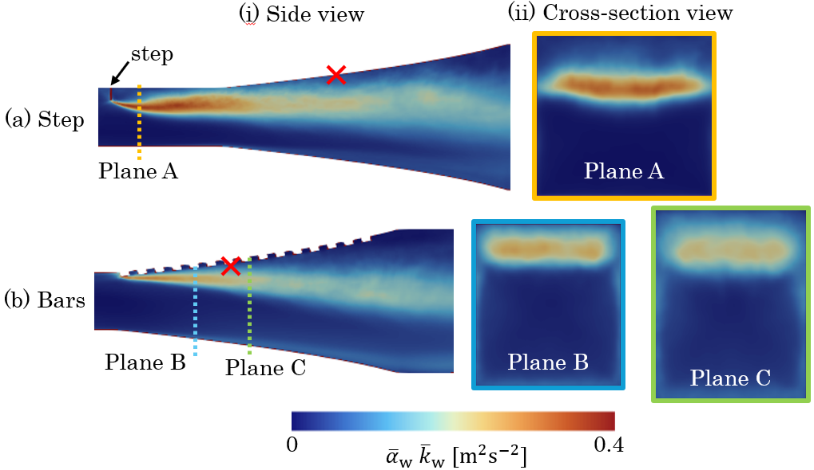
ᾱw k̄w at mid-span (i) and in cross-sections (ii) for (a) step and (b) bars. The cross marks the reference phase-separation point.

In 3D, the extra mixing from both the step and the first bar starts **well upstream of the phase-separation point**, which is why the bars now work in the simulation. Away from the walls the mixing is nearly uniform across the span, so it acts on the whole width.

## Pressure recovery

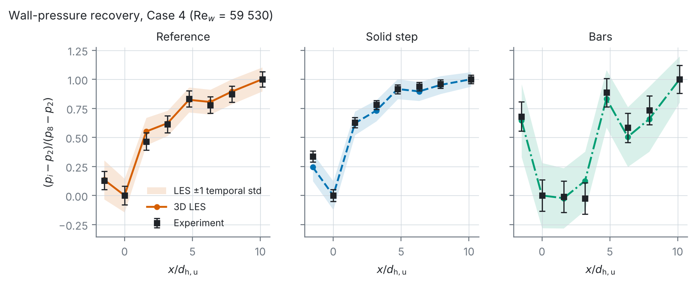
(pi − p2)/(p8 − p2): experiment with uncertainty, LES with ±1 temporal standard deviation. Data: [`data/pressure_recovery_3d.csv`](../data/pressure_recovery_3d.csv).

- Simulation and experiment agree within the measurement uncertainty for all three configurations.
- **Step:** clearly better recovery; the pressure reaches its final level further upstream.
- **Bars:** recovery stays below the reference despite the smaller continuous pocket. The bars add form drag, local acceleration, wakes and turbulence production, all irreversible losses. In addition, the reference tap P2 sits close to the first bar and may be affected by it, so this curve should not be read only as worse global performance.

> **Mitigating air accumulation does not automatically improve the diffuser.** Phase dispersion and hydraulic losses have to be balanced.

## Mechanism: breakup versus coalescence

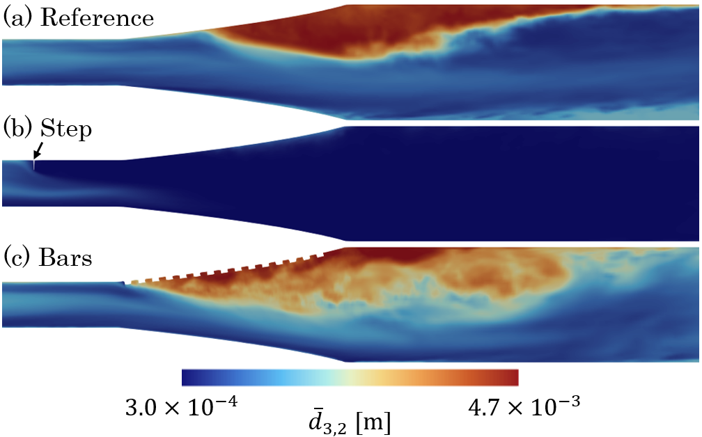
Time-averaged d̄32 at mid-span: (a) reference, (b) step, (c) bars.

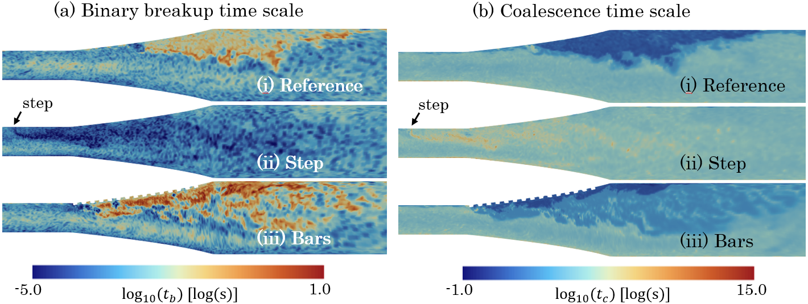
Instantaneous (a) breakup time scale tb = 1/Ω0 and (b) coalescence time scale tc = v0/(Γ0 αa), with v0 = π d32³/6. Lower values mean more activity.

- **Reference:** large bubbles collect in the separated region, driven by coalescence.
- **Step:** small bubbles everywhere, from intense breakup.
- **Bars:** breakup only around the first few bars, none downstream of the third; coalescence stays active through and beyond the diffuser.

The time scales are shown instantaneously on purpose. ε enters the kernels non-linearly (breakup through ε1/3 and exp(−ε−2/3)), and the dissipation rate is highly intermittent, so breakup and coalescence are driven by rare intense events that a time average would smooth out. [`postprocessing/pbm_kernels.py`](../postprocessing/pbm_kernels.py) shows this sensitivity: tb falls by orders of magnitude as ε rises, while tc changes little.

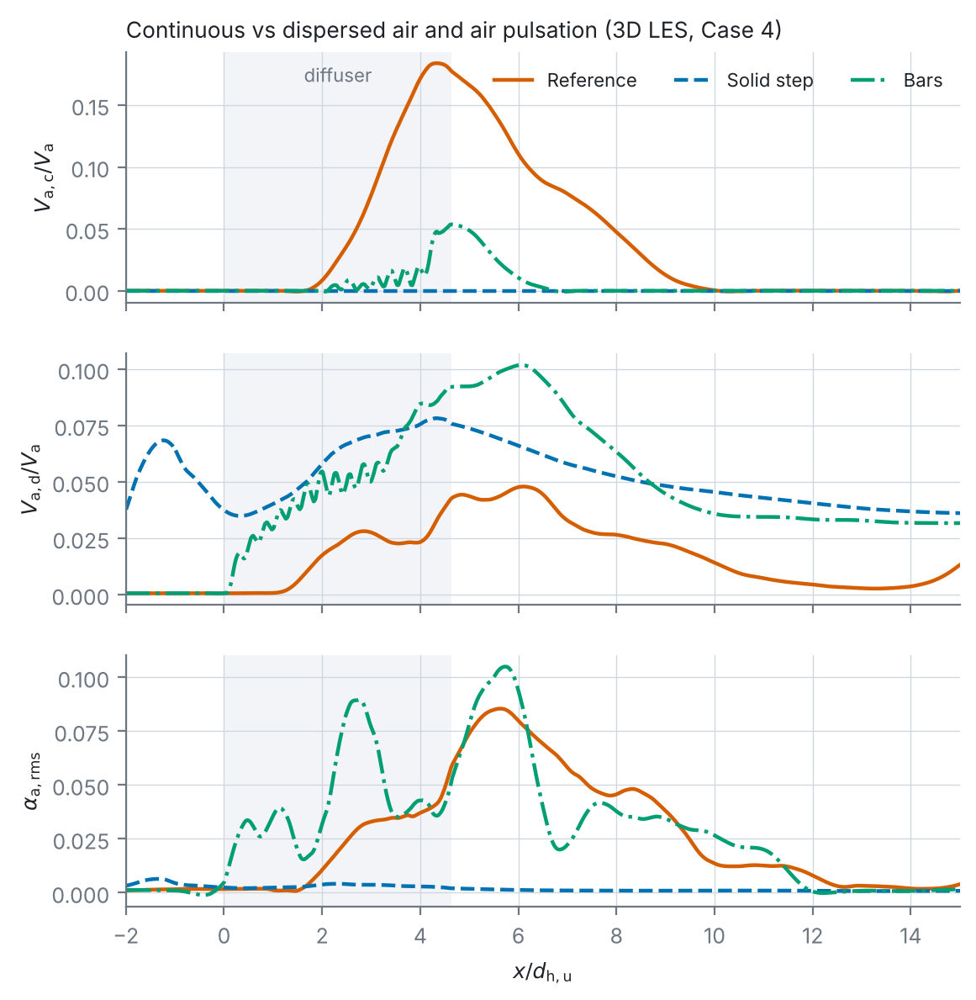
Cross-section integrals along the channel: continuous and dispersed air volume relative to the total air volume, and the RMS air fraction. Data: [`data/streamwise_profiles_3d.csv`](../data/streamwise_profiles_3d.csv).

- **Reference:** continuous air dominates, with a pronounced peak; one pulsation region (αa,rms peak) near x/dh,u ≈ 6 where the pocket grows and sheds.
- **Step:** almost no continuous air; total air negligible; no pulsation, so mitigation is an essentially steady process.
- **Bars:** much less continuous air but considerable dispersed air (the +48 % AVF above); an additional pulsation region near x/dh,u ≈ 3, midway along the diffuser.

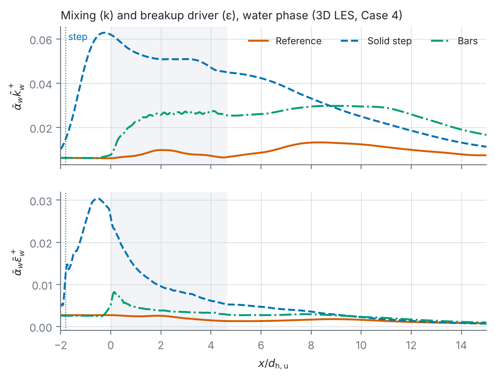
ᾱwk̄w+ = ᾱwk̄w/cbulk² and ᾱwε̄w+ = ᾱwε̄wdh,u/cbulk³, cross-section averaged.

The step (at x/dh,u = −1.8) produces sharp peaks in **both** k and ε. The bars raise k substantially within and after the diffuser, but less than the step, and ε only marginally. Fewer intense dissipation events mean less breakup, which explains why the bars are less effective than the step.
